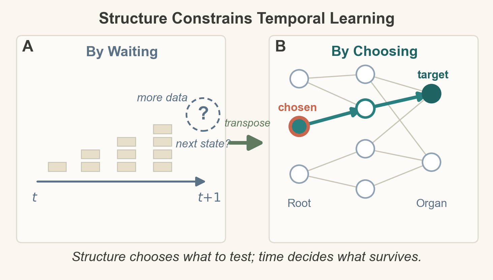
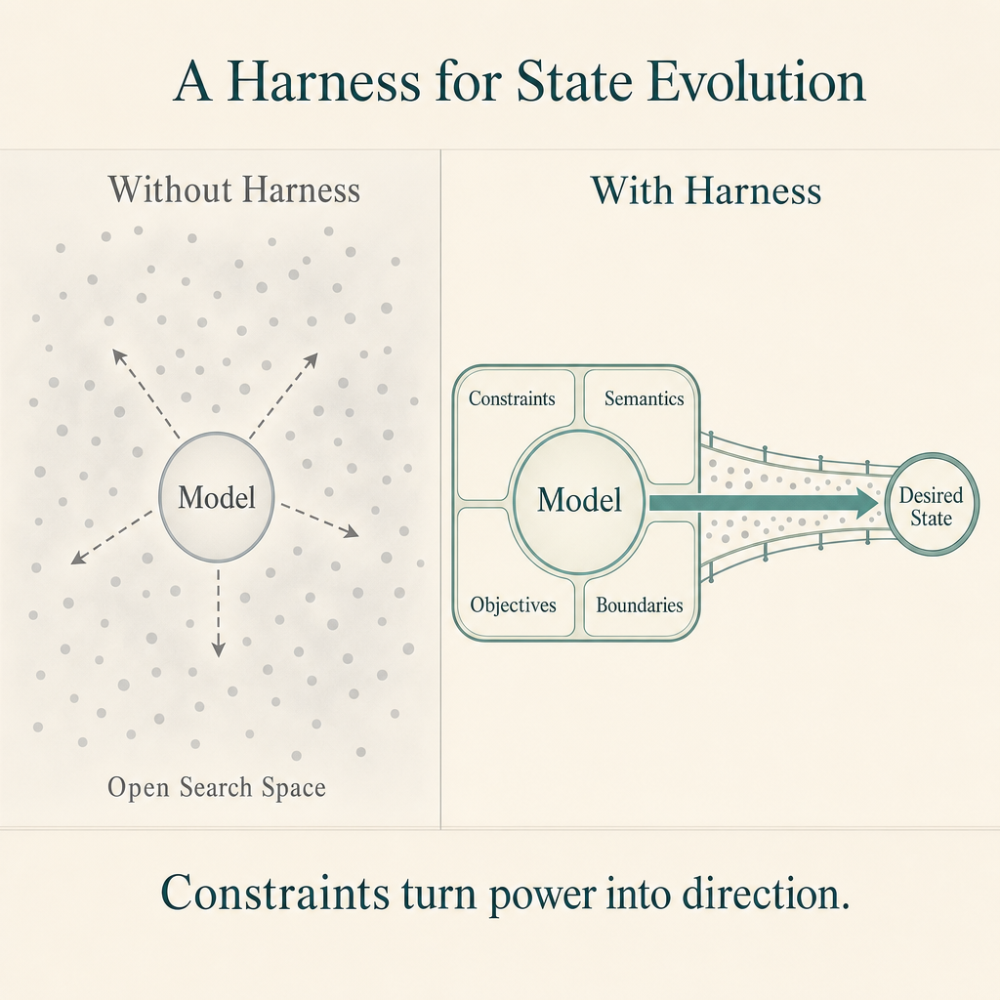

<div align="center">

# SteeraMed-Selection-Intelligence

**World Models for Biomedicine: Prediction Is the Means, Selection Is the End**

[](https://doi.org/10.20944/preprints202609.2101.v1)
[](LICENSE)

A perspective paper proposing **predictability before prediction** — a falsifiable route toward intervention-oriented biomedical world models, at a stage before longitudinal data are abundant.

[English](#english) | [中文](#中文)

</div>

---

## English

### The claim, in one sentence

For deciding interventions, a prediction matters only when it improves **selection** — the choice of which action to take for *this* person, *now*. This perspective transposes the problem of biomedical world models from temporal prediction to **spatial selection**: learning the dependency structure that constrains which transitions are worth testing, before trying to predict everything.

<p align="center">
  
</p>
<p align="center"><em>Figure 1. (A) By waiting: data accumulate along the timeline and the next state remains a question mark. (B) By choosing: a candidate upstream node and its downstream target define a directional transition hypothesis, assessed with paired before-and-after observations. Structure does not replace longitudinal evidence — it narrows the candidate transitions that scarce longitudinal observations are asked to test.</em></p>

### The three-step route

1. **State map** — health is represented as 332 named gene modules, each carrying an interpretable capability score (the mIC vector), so where a person stands becomes compressed and readable.
2. **Dependency structure** — learn which modules regulate which. An open 332 × 1,916 drug-module matrix already records what each intervention is expected to move; an initial hallmark-to-organ dependency map is under construction.
3. **Paired testing** — test the map against paired before-and-after data at the individual scale, the data type the field names as its binding constraint. Negative results mark where prediction is not supported.

Selection then has a working definition: **act where the map and the data agree; stay out where they disagree.**

### The deliverable is a harness, not a bigger predictor

<p align="center">
  
</p>
<p align="center"><em>Figure 2. Left: a raw next-state predictor, like a raw language model, can go anywhere — a liability in medicine. Right: an engineered harness wraps the model with constraints, intervention semantics, objectives, and boundaries. The shepherd principle carries the same idea: study where the water and grass are, where the wolves are, and plan a declared path.</em></p>

Five constraint checkpoints (CP1–CP5) form a closed loop — from state representation (module-level intrinsic capabilities), through shared intervention-response encoding, to five-gate inspection in which a failed prediction becomes a diagnosable signal rather than an opaque negative. This is what the program's term **steerability** has always meant: the biological counterpart of what turns a raw language model into a useful and bounded system.

The route is anchored by two published studies — a steerable N-of-1 reasoning engine and a public 332 × 1,916 drug-module benchmark — with further steps scheduled as ongoing work. The contribution is a **proposed and falsifiable route**, not a validated clinical decision system.

### Status of this repository

- **v1 (current):** bilingual README, representative figures, and version statement. The citable version of record is the preprint (DOI below).
- **Later:** figures, evaluation scripts, and the dependency-map artifacts will be released here in step with the research program.

### Citation

```bibtex
@article{xiong2026worldmodels,
  title   = {World Models for Biomedicine: Prediction Is the Means, Selection Is the End},
  author  = {Xiong, Jianghui},
  journal = {Preprints},
  year    = {2026},
  doi     = {10.20944/preprints202609.2101}
}
```

### Links

| Resource | Link |
| --- | --- |
| Preprint (DOI) | https://doi.org/10.20944/preprints202609.2101.v1 |
| Preprints.org page | https://www.preprints.org/manuscript/202609.2101/v1 |
| SteeraMed platform | https://steeramed.com |
| DeepoMe | https://www.deepome.com |

**Sister repositories**

- [SteeraMed-bench](https://github.com/DeepoMe/SteeraMed-bench) — 332 × 1,916 drug-module benchmark for self-learning AI drug repurposing
- [SteeraMed-RootMap](https://github.com/DeepoMe/SteeraMed-RootMap) — root-cause attribution framework (the steerable N-of-1 reasoning engine)
- [SteeraMed-MorbidMap](https://github.com/DeepoMe/SteeraMed-MorbidMap) — multi-morbidity pattern mining with LLMs
- [Good-Healthspan-Practice](https://github.com/DeepoMe/Good-Healthspan-Practice) — good-practice guide for N-of-1 evidence in longevity medicine

### License

This repository (README, figures) is released under the [MIT License](LICENSE).

### Contact

- Jianghui Xiong (author) — jianghui@deepome.com
- [DeepoMe Limited](https://www.deepome.com)

---

## 中文

### 一句话主张

对干预决策而言，预测只有能改进**选择**——*此时*对*这个人*该采取什么行动——才有价值。本文将生物医学世界模型的问题从时间维度的预测转置为**空间维度的选择**：先学习约束"哪些转变值得检验"的依赖结构，而不是试图预测一切。

### 三步路线

1. **状态图** — 健康被表示为 332 个命名基因模块，每个模块携带可解读的能力分数（mIC 向量），一个人的状态因此被压缩、可读。
2. **依赖结构** — 学习哪些模块调控哪些。一个开放的 332 × 1,916 药物-模块矩阵已记录每个干预预期移动什么；衰老标识-器官依赖图正在构建中。
3. **配对检验** — 用个体尺度的前后配对数据检验地图——该领域公认的束缚性数据类型。阴性结果标记预测不被支持的区域。

选择由此有了可操作定义：**地图与数据一致处行动，不一致处不行动。**

### 交付物是"缰绳"，不是更大的预测器

五个约束检查点（CP1–CP5）构成闭环——从状态表示（模块级内禀能力），到共享的干预-响应编码，再到五门检查：预测失败成为可诊断的信号而非不透明的阴性。这就是本项目术语 **steerability（可驾驭性）** 的含义：让原始语言模型变成有用且有界系统的那套工程，在生物学中的对应物。

路线由两项已发表研究锚定——可驾驭的 N-of-1 推理引擎与公开的 332 × 1,916 药物-模块基准——后续步骤按计划推进。本文的贡献是一条**可提出且可证伪的路线**，不是已验证的临床决策系统。

### 仓库状态

- **v1（当前）：** 中英文 README、代表性图件与版本声明。可引用的正式版本为预印本（见下方 DOI）。
- **后续：** 图件、评估脚本与依赖图产物将随研究计划在本仓库逐步放出。

### 引用

```bibtex
@article{xiong2026worldmodels,
  title   = {World Models for Biomedicine: Prediction Is the Means, Selection Is the End},
  author  = {Xiong, Jianghui},
  journal = {Preprints},
  year    = {2026},
  doi     = {10.20944/preprints202609.2101}
}
```

### 链接

| 资源 | 链接 |
| --- | --- |
| 预印本（DOI） | https://doi.org/10.20944/preprints202609.2101.v1 |
| Preprints.org 页面 | https://www.preprints.org/manuscript/202609.2101/v1 |
| SteeraMed 平台 | https://steeramed.com |
| DeepoMe | https://www.deepome.com |

**姊妹仓库**

- [SteeraMed-bench](https://github.com/DeepoMe/SteeraMed-bench) — 332 × 1,916 药物-模块基准（自学习 AI 药物重定位）
- [SteeraMed-RootMap](https://github.com/DeepoMe/SteeraMed-RootMap) — 根因归因框架（可驾驭的 N-of-1 推理引擎）
- [SteeraMed-MorbidMap](https://github.com/DeepoMe/SteeraMed-MorbidMap) — 大模型多病共存模式挖掘
- [Good-Healthspan-Practice](https://github.com/DeepoMe/Good-Healthspan-Practice) — 长寿医学 N-of-1 证据良好实践指南

### 许可

本仓库（README、图件）以 [MIT 许可](LICENSE)发布。

### 联系方式

- 熊江辉（作者）— jianghui@deepome.com
- [DeepoMe Limited](https://www.deepome.com)
